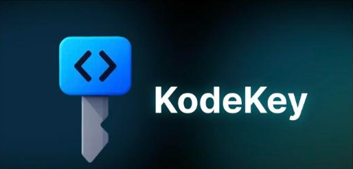

  

<h1 align="center">KodeKey Enabled Projects</h1>

  Hands-on projects powered by <b>KodeKey</b> - KodeKloud's AI playground - that reach frontier
  models (GPT, Claude, Gemini and more) through a single unified API key.

  <a href="https://kodekloud.com/ai-playgrounds/kodekey"><b>▶ Open the KodeKey playground</b></a>

---

## What is KodeKey?

**KodeKey is your personal launchpad into AI upskilling and experimentation** - instant access to
frontier models like **GPT-5, Claude, and Gemini through one unified API key**. It's built for
**learning and short experiments**, not production-grade or large-scale application development.

No more juggling multiple AI providers, separate accounts, API keys, and SDKs. KodeKey is a
plug-and-play solution, so you spend your time learning instead of configuring.

### Why these projects use it

- **One key, many providers** - reach OpenAI, Anthropic, Google, xAI, DeepSeek, Moonshot and MiniMax models through a single key.
- **Learner-first** - copy-paste-ready examples in Python, JavaScript and cURL; you're never starting from a blank file.
- **Works beyond the browser** - take the same key into a CLI, script, or notebook with minimal friction.
- **Safe to explore** - monthly credit resets, real-time token tracking, encrypted keys, and prompt guardrails. Prompts are never used for training.

> ℹ️ Think of KodeKey as your AI lab - safe to explore, experiment, and compare models in real time. It's for learning and testing, not production.

---

## Projects in this category

Each project runs on a KodeKey-enabled playground. Open a project for its full walkthrough and ready-to-run files.

### N8N | KodeKey Playground
| Project | What it does |
|---|---|
| [AI Email Sorter](./n8n-kodekey-playground/smart-customer-email-triage-ai) | Auto-classifies and routes support emails with an LLM inside an n8n workflow. |
| [ResumeRadar - AI CV Reviewer](./n8n-kodekey-playground/n8n-resume-radar-import) | Webhook-backed page that scores a CV against a job ad using three vendors' models on one key. |

### Kubernetes | KodeKey Playground
| Project | What it does |
|---|---|
| [AI Security Log Monitor](./kubernetes-kodekey-playground/autonomous-secops-agent) | Streams pod logs, flags attacks with regex + an LLM, and sends Gotify alerts under least-privilege RBAC. |

### AWS Terraform | KodeKey Playground
| Project | What it does |
|---|---|
| [AWS 3-Tier App (Terraform)](./aws-terraform-kodekey-playground/three-tier-application-aws-terraform-private-ecs-nat) | Secure three-tier AI application on AWS with private ECS and a NAT gateway, provisioned by Terraform. |

### Python | KodeKey Playground
| Project | What it does |
|---|---|
| [AI Financial Data Extractor](./python-kodekey-playground/type-safe-financial-extraction-engine) | Extracts structured, validated financial data from documents using pydantic-ai. |

### AWS | KodeKey
| Project | What it does |
|---|---|
| [AI Cloud Cost Monitor](./aws-kodekey/cloud-cost-pulse-realtime-finops-lakehouse-2) | Streaming FinOps lakehouse that detects cost anomalies and explains them with an LLM. |

---

Learn more about KodeKey at <a href="https://kodekloud.com/ai-playgrounds/kodekey">kodekloud.com/ai-playgrounds/kodekey</a>.
